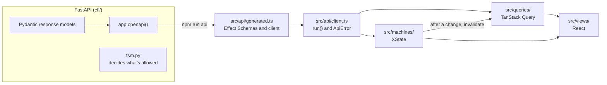
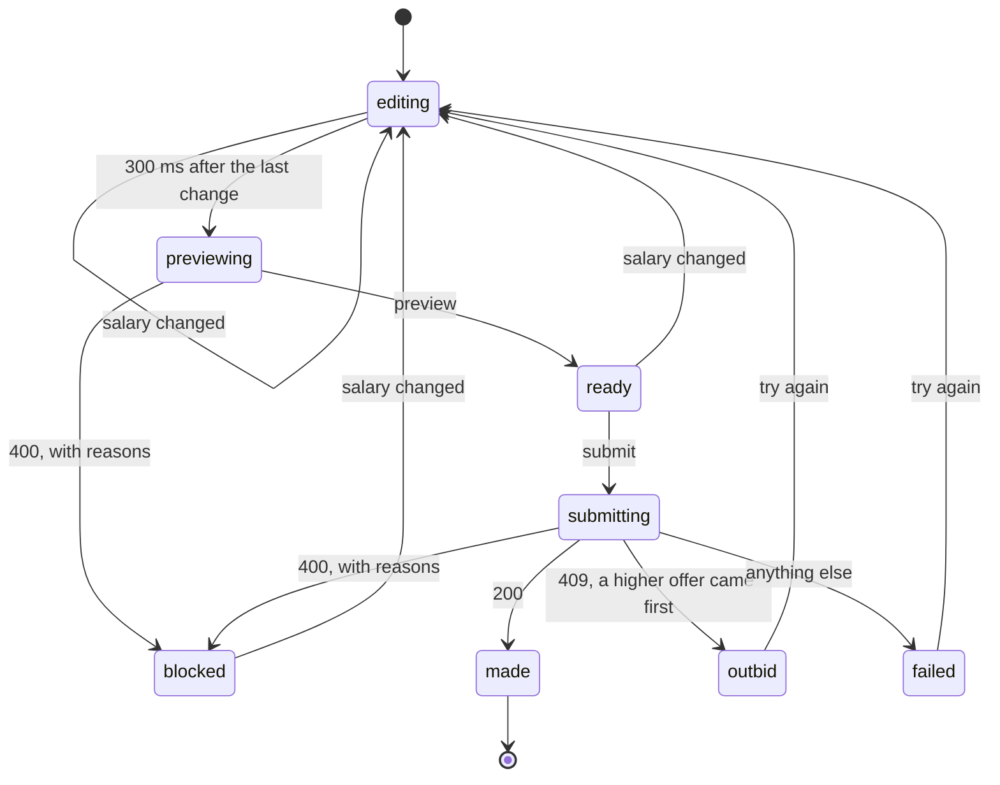

# Frontend plan: React, TypeScript, Effect and XState

A plan to move the web app from one JavaScript file to a typed, component-based frontend. The
offseason features in [offseason-plan.md](offseason-plan.md) are the reason: offer sheets and the
draft room are workflows, and the current file has no good place for them. The API keeps its role:
FastAPI owns every rule and every state machine.

Status: accepted on October 20, 2026 (see [Decisions](#decisions)). F0 and F1 are done. The "Your
account" card is the first React view in the page. F2 waits for offseason milestone 1.

## Why now

The page is [`cfl/web/app.js`](../cfl/web/app.js) (2,300 lines) and 360 lines of static HTML. It
works well for today's tabs, which load data and show it. It does that with parts made by hand:

- A DOM builder, `h()`, and `byId()` lookups into `index.html`.
- One global `state` object with about 30 fields.
- Request counters (`seqs`, `playersSeq`, `offseasonSeq` and others), so a slow old response can't
  replace a newer one.
- Caches in `Map`s that `resetCaches()` clears by hand after a sync or an edit.
- Debounce timers in module variables.

The offseason adds screens that are workflows, not views:

- **Offer sheets.** A GM types a salary and sees the compensation and the cap and bank impact. Then
  they submit. The offer can be made, blocked with reasons (400), or outbid while they typed (409).
- **Matching.** The owner sees a 24-hour countdown and chooses Match or Let go before it ends.
- **The draft room.** The board changes while the page is open. The clock can run out, and the app
  can auto-pick, while a GM is choosing.
- **Phase transitions.** The admin sees the blockers, confirms, and can force with a reason.
  Another admin can move the phase first.

In today's style, each of these adds counters, timers and flags to `state`, and nothing keeps them
consistent. Also, nothing in the page knows the API's shapes, and the offseason adds about 15
endpoints.

## What stays the same

- **The server decides.** The domain machines stay in Python ([`cfl/fsm.py`](../cfl/fsm.py)). The
  page never decides whether a move is allowed. It shows the triggers and blockers that
  `available()` returns, and it handles the API's 400, 403 and 409.
- **Hash routes** (`#dashboard`, `#offseason`). The API's paths are at the root (`/players`,
  `/changes`, `/offseason`), so page paths like `/players` would collide with them. Hash routes
  mean the API doesn't have to move under `/api`.
- **One Vercel project and one deployment.** FastAPI still serves the page.
- **Logins.** The session is a same-origin cookie, as today.
- **`styles.css`.** The legacy markup keeps its classes (`card`, `kpis`, `tile`, `pill`,
  `segmented`). React views use Mantine, themed to its tokens (see [the stack](#the-stack)).

## The stack

| Concern | Choice | Why |
|---|---|---|
| Language | TypeScript 7, `strict` | Types for the API's shapes, and for each machine's states and events. |
| UI | React 19 | XState's and Effect's React bindings target React. It has the most libraries and examples. |
| Components | Mantine 9 | Each component's CSS is imported on its own, in Mantine's CSS layer, so `styles.css` wins any conflict. Its variables point at the `styles.css` tokens, and dark mode follows `data-theme` (`src/views/theme.ts`). |
| Build | Vite 8 | A dev server with Fast Refresh and a proxy to FastAPI. Production builds with hashed file names. |
| Server data | TanStack Query 5 | Caching, deduplication, invalidation, refetch on focus and polling. It replaces `cached()`, the request counters and `resetCaches()`. |
| API calls and errors | Effect 4 | Decoded responses, typed errors for 400/403/409, cancellation and retries. Only in `src/api/` (see [Effect](#effect-the-api-boundary)). |
| API types | `@effect/openapi-generator` | Generates Effect Schemas and a client from FastAPI's OpenAPI document, so Python stays the one source of the shapes. |
| Workflows | XState 5 | Only for the four workflows above (see [XState](#xstate-workflows-only)). |
| Tests | Vitest 5, Testing Library, MSW 3 | MSW mocks the network, which is the page's boundary. |
| Lint and format | Biome 2 | One tool and one config file for both. It skips the legacy files: `src/legacy/`, `styles.css` and the HTML. |
| Packages | npm | It comes with Node, so Vercel and a new checkout need nothing else. |

Routing stays as it is until React owns the page's shell (see [Migration](#migration)). At that
point, decide whether TanStack Router's typed search params are worth one more library.

### Alternatives considered

| Option | For | Against |
|---|---|---|
| Plain JavaScript, split into ES modules with JSDoc types | No new libraries. | No components. The offseason workflows still need hand-made state, and Effect and XState have little to do. |
| htmx with templates rendered on the server | Fits FastAPI. No JavaScript build. | The draft room and the trade builder are interactive. Rendering moves into Python. No use for Effect or XState. |
| Preact | A much smaller runtime with React's API. | The XState and Effect bindings target React, so Preact needs its compatibility layer. |
| Svelte 5 or Solid | Smaller and faster than React. | A second way to think about UI. Fewer people use their XState and Effect bindings. |
| `@effect/atom-react` instead of TanStack Query | The official Effect binding. Typed errors reach components as values. | Its first stable release came with Effect 4 in October 2026, and few examples exist yet. A later switch stays inside `src/queries/`. |
| shadcn/ui on Tailwind instead of Mantine | You own the components' code. Theming is CSS variables. | Tailwind's reset restyles the legacy page. A CSS framework to learn, on top of Effect and XState. The components are copied into the repo. |

React's runtime is the largest of these. That doesn't matter for an app that 11 GMs use. With
React, TanStack Query and Effect in one file, the page was 146 kB gzipped. The legacy page alone is 25 kB.
`app.js` now loads the React side only when a view needs it (see [the bridge](#the-bridge)).

## How the pieces fit



Two rules keep the parts apart:

- **Effect stays at the boundary.** Only `src/api/` and the actors that machines invoke use Effect.
  Components get plain data and typed errors, and never see an `Effect` value. So the cost of
  learning Effect stays in one folder.
- **A client machine holds the interaction, not the domain.**

| | Server machine (`fsm.py`) | Client machine (XState) |
|---|---|---|
| Example | An offer sheet: pending, matched, let go, expired, outbid | The offer form: editing, previewing, submitting, outbid |
| Decides | Whether a move is allowed, and who may make it | What the screen shows now |
| Lives | In Postgres, for the whole offseason | In memory, while the form is open |
| After a change | Logs it in `machine_events` | Invalidates queries, so the server's new state loads |

### Effect: the API boundary

What Effect does here:

- **It decodes every response** with the generated Schemas. A shape that doesn't match is one clear
  error at the boundary, not a crash deep in a component.
- **It types the errors.** The offseason API answers 409 for a wrong state, 403 for a wrong person
  and 400 with the guard's reasons. Each becomes a tagged error that code matches by name, for
  example `Effect.catchTag("Blocked", ...)` or `error instanceof Blocked`.
- **It cancels.** TanStack Query's abort signal interrupts the call and its `fetch`. This replaces
  the request counters.
- **Retries are TanStack Query's.** It retries a failed query, and the query client limits that to
  `Failed` with status 0, a network error such as a cold start.

```ts
// src/api/errors.ts
import { Data } from "effect";

export class Unauthorized extends Data.TaggedError("Unauthorized") {}
export class Forbidden extends Data.TaggedError("Forbidden")<{ readonly message: string }> {}
export class Conflict extends Data.TaggedError("Conflict")<{ readonly message: string }> {}
export class Blocked extends Data.TaggedError("Blocked")<{ readonly reasons: ReadonlyArray<string> }> {}
export class NotSynced extends Data.TaggedError("NotSynced")<{ readonly message: string }> {}
export class Failed extends Data.TaggedError("Failed")<{ readonly status: number; readonly message: string }> {}

export type ApiError = Unauthorized | Forbidden | Conflict | Blocked | NotSynced | Failed;
```

```ts
// src/api/client.ts (part)
export const cfl = make(Effect.runSync(Effect.provide(Effect.service(HttpClient.HttpClient), FetchHttpClient.layer)));

// Rejects with an ApiError, so TanStack Query's `error` is typed.
export async function run<A, E>(call: Effect.Effect<A, E>, signal?: AbortSignal): Promise<A> {
  const exit = await Effect.runPromiseExit(call, { signal });
  if (Exit.isSuccess(exit)) return exit.value;
  const error = Cause.squash(exit.cause);
  if (HttpClientError.isHttpClientError(error) && error.reason._tag === "StatusCodeError") {
    throw apiError(error.reason.response.status, Option.getOrUndefined(fromJson(error.reason.description)));
  }
  throw new Failed({ status: 0, message: String(error) });
}
```

`cfl` is the generated client, built once over `fetch`, so a call is one expression:
`run(cfl.teamOverview(teamId, undefined), signal)`. `apiError()` turns each failed response into
an `ApiError`. It decodes the body with an Effect Schema:

| Response | Error |
|---|---|
| 401 | `Unauthorized`. The page shows sign-in, as today. |
| 403 | `Forbidden` |
| 409 with `code: "conflict"` | `Conflict`. Someone else moved it first. |
| Any other 409 | `NotSynced`, the existing "League not synced yet" |
| 400 with `code: "blocked"` | `Blocked`, with the guard's reasons |
| Any other status | `Failed`, with the status and the body's `detail` or `detail.error` |
| The network fails, the call is aborted, or anything else | `Failed`, with status 0 |

Effect 4.0.0 came out on October 1, 2026. Effect marks its core and `Schema` stable. It marks its
HTTP modules (`effect/http`) unstable, so a minor release can change them. Pin `effect` and
`@effect/openapi-generator` to the same exact version, upgrade them together, and regenerate.

### TanStack Query: server data

```ts
// src/queries/client.ts
export const queryClient = new QueryClient({
  defaultOptions: {
    queries: { retry: (failures, error) => error instanceof Failed && error.status === 0 && failures < 3 },
  },
});

declare module "@tanstack/react-query" {
  interface Register {
    defaultError: ApiError;
  }
}
```

```ts
// src/queries/draft.ts
export const draftBoard = queryOptions({
  queryKey: ["draft"],
  queryFn: ({ signal }) => run(cfl.draft(undefined), signal),   // cfl: the generated client
  refetchInterval: 30_000,   // TanStack Query polls only while the tab is visible
});
```

`cfl.draft` is the generated method for a `GET /draft` route whose function is `draft` (see
[the API contract](#the-api-contract)).

### XState: workflows only

| Machine | States | Why it's a machine |
|---|---|---|
| `offerSheet` | editing, previewing, ready, blocked, submitting, made, outbid, failed | A preview after each pause in typing, then a submit that can fail in three ways. |
| `matchDecision` | deciding, confirming, submitting, done, expired | The 24 hours can run out while the owner decides. |
| `draftPick` | waiting, on_clock, choosing, submitting, picked, missed | The clock or an auto-pick can end the turn during a pick. |
| `phaseTransition` | idle, previewing, confirming, forcing, submitting, done, conflict | A preview, a confirm, an optional reason to force, and a race with another admin. |

The other screens aren't machines: Dashboard, Analysis, Players & cap, Changes, Rules and the trade
builder. They load data and show it, and TanStack Query and React state cover that. The trade
builder's live evaluation is a query keyed by the selected players.

The offer form:



Part of the machine:

```ts
// src/machines/offerSheet.ts
export const offerSheet = setup({
  types: {
    context: {} as { playerId: string; salary: number; preview: OfferPreview | null; reasons: ReadonlyArray<string> },
    events: {} as { type: "SALARY"; salary: number } | { type: "SUBMIT" } | { type: "RETRY" },
    input: {} as { playerId: string; minSalary: number },
  },
  actors: {
    preview: fromPromise(({ input, signal }: { input: NewOffer; signal: AbortSignal }) => run(cfl.previewOffer(input), signal)),
    makeOffer: fromPromise(({ input, signal }: { input: NewOffer; signal: AbortSignal }) => run(cfl.makeOffer(input), signal)),
  },
}).createMachine({
  // ...
  states: {
    editing: {
      after: { 300: "previewing" },
      on: { SALARY: { target: "editing", reenter: true, actions: assign({ salary: ({ event }) => event.salary }) } },
    },
    // ...
    submitting: {
      invoke: {
        src: "makeOffer",
        input: ({ context }) => ({ player_id: context.playerId, salary: context.salary }),
        onDone: { target: "made", actions: () => dataChanged() },
        onError: [
          { guard: ({ event }) => event.error instanceof Conflict, target: "outbid", actions: () => dataChanged() },
          {
            guard: ({ event }) => event.error instanceof Blocked,
            target: "blocked",
            actions: assign({ reasons: ({ event }) => (event.error instanceof Blocked ? event.error.reasons : []) }),
          },
          { target: "failed" },
        ],
      },
    },
  },
});
```

`reenter: true` restarts the 300 ms timer on each change. `dataChanged()` invalidates the queries
(see [the bridge](#the-bridge)), so the RFA market loads the new high offer.

## The API contract

Today's routes return plain dicts, so FastAPI's OpenAPI document has no response schemas.

- **New endpoints get Pydantic response models from the start.** That's every endpoint in the
  offseason plan.
- **An existing endpoint gets one when its tab moves to React.** There's no pass over all 39 routes
  at once.
- **`npm run api` regenerates the client.** A new CLI command, `python -m cfl openapi`, writes
  `app.openapi()` to `frontend/openapi.json`. Then `openapigen` writes `src/api/generated.ts` from
  it.
- **Operation IDs are the route functions' names,** so `GET /teams/{team_id}/overview` is
  `cfl.teamOverview(teamId, undefined)`. Each method takes an options argument, often `undefined`.
- **Commit both files,** so a change to the contract shows in review.
- **A pytest test compares `frontend/openapi.json` with `app.openapi()`.** A Python change without
  `npm run api` fails `pytest`.

### Error bodies

Existing errors keep their `detail` string, which the legacy page reads. The offseason's `fsm.py`
errors get one body with a code:

```json
{"detail": {"code": "blocked", "error": "This offer can't be made", "reasons": ["Not enough cap space: $4 short"]}}
{"detail": {"code": "conflict", "error": "Someone else moved it first"}}
```

`error` is the key the legacy page already reads (see `request()` in `app.js`), so it shows these
messages too. The code tells a `Conflict` from the existing 409 for an unsynced league
(`A.NotSynced`).

### What the frontend needs from the offseason API

[offseason-plan.md](offseason-plan.md#api-and-ui) lists these with its endpoints:

- **Previews.** For example, `GET /offer-sheets/preview?player_id=…&salary=…` returns the
  compensation, the cap and bank after the offer, and the guard's reasons. It runs the same guard
  code that `fire()` runs, so the page never computes a rule itself.
- **The server's time.** Each response with a deadline (`/offseason/state`, `/offer-sheets`,
  `/draft`) includes `now`. Countdowns use the server's clock, so a wrong clock on a GM's computer
  can't show the wrong time left.
- **One read per screen.** `GET /draft` returns the whole board, so one poll updates the screen.

## Layout

```text
frontend/
  package.json  tsconfig.json  vite.config.ts  biome.json
  openapi.json            generated from cfl/api.py by npm run api, committed
  index.html              was cfl/web/index.html
  privacy.html            was cfl/web/privacy.html
  src/
    main.ts               imports styles.css and legacy/app.js
    styles.css            was cfl/web/styles.css
    legacy/app.js         was cfl/web/app.js, and shrinks as each tab moves
    bridge.ts             legacy ↔ React, deleted with app.js
    format.ts             fmtMoney, ordinal, fmtCat, ... (moved out of app.js)
    api/
      generated.ts        never edited by hand
      errors.ts
      client.ts
    queries/              one file per resource: keys and queryOptions
    machines/             XState machines, with no React imports
    components/           the app's own components, built on Mantine
    views/                one folder per tab: offseason/, rules/, draft/, ...
      theme.ts            Mantine's CSS imports, the theme, and the color-scheme bridge
      Providers.tsx       Mantine and TanStack Query, for mountView and the tests
      test-utils.tsx      renderView()
    test-setup.ts         matchMedia for jsdom
cfl/web/dist/             the build, which git ignores and FastAPI serves
```

## Build, dev and deploy

**Build.** Vite builds `frontend/` into `cfl/web/dist/`. FastAPI serves it as it serves `cfl/web/`
today:

- `/` serves `dist/index.html`, with `no-cache` as today.
- `/privacy` serves `dist/privacy.html`.
- `/static` serves `dist/`. Vite gives each file a hashed name, such as
  `/static/assets/main-3f9a1c.js`, so browsers can keep the files for a year. `NoCacheStaticFiles`
  goes away.

**Vercel.** A new `vercel.json` runs the build:

```json
{
  "buildCommand": "cd frontend && npm ci && npm run build",
  "headers": [
    {
      "source": "/static/assets/(.*)",
      "headers": [{ "key": "Cache-Control", "value": "public, max-age=31536000, immutable" }]
    }
  ]
}
```

Vercel serves a FastAPI `StaticFiles` mount from its CDN when the app has no top-level middleware.
This app has none, so the bundle never reaches the Python function. Vercel's build image has Node 22
and 24. This is the project's first Node build on Vercel, so milestone F0 proves it on a preview
deployment before anything else.

**Without Node.** The CLI, `pytest` and the API must keep working without Node or a build:

- The `/static` mount doesn't check at import that `dist/` exists (`check_dir=False`).
- The three tests that load `/` or `/privacy` use a stub build directory: a `web_build` fixture
  writes one into `tmp_path`.

**Dev.** Two processes:

- `python -m cfl serve --reload` runs the API on port 8000, as today.
- `npm run dev` in `frontend/` runs the page on port 5173, with Fast Refresh.

Vite's proxy sends API requests to port 8000. The API's paths are at the root, so the config takes
each path's first segment from `openapi.json`, and a new endpoint needs no proxy change. The proxy
keeps the browser's `Host` header (no `changeOrigin`), so the API's same-site check passes when
logins are on locally. `.claude/launch.json` gets a second entry for the Vite server.

```ts
// frontend/vite.config.ts
import react from "@vitejs/plugin-react";
import { defineConfig } from "vite";
import openapi from "./openapi.json" with { type: "json" };

const prefixes = new Set(Object.keys(openapi.paths).map((path) => `/${path.split("/")[1]}`));

export default defineConfig(({ command }) => ({
  plugins: [react()],
  base: command === "build" ? "/static/" : "/",
  build: { outDir: "../cfl/web/dist", emptyOutDir: true, rolldownOptions: { input: ["index.html", "privacy.html"] } },
  server: { proxy: Object.fromEntries([...prefixes].map((prefix) => [prefix, "http://127.0.0.1:8000"])) },
}));
```

## Migration

There's no rewrite. React views mount inside the current page, one tab at a time, new screens
first. The legacy app keeps the header, the tabs and the hash routing until the end.

Vite bundles `app.js` as an ES module from F0. It needs no edits for that. It already runs in strict
mode and reads only browser globals and Google's `google` object, which work the same in a module.
Because it's a module, it can import from TypeScript files. So shared code moves once, and both
sides use the one copy.

### The bridge

```ts
// src/bridge.ts
const listeners = new Set<() => void>();

export function onDataChanged(listener: () => void) {
  listeners.add(listener);
}

export function dataChanged() {
  queryClient.invalidateQueries();
  for (const listener of listeners) listener();
}

// onSignedOut(listener) is the same, for a query that fails with Unauthorized (the cache is watched).
```

```js
// src/legacy/app.js
import { dataChanged, onDataChanged, onSignedOut } from "../bridge";

onDataChanged(resetCaches);
onSignedOut(showSignIn);
// renderAccount():  Promise.all([import("../views/mount"), import("../views/account/AccountCard")])
//                     .then(([{ mountView }, { AccountCard }]) => mountView(byId("account-card"), AccountCard))
// after an edit:    dataChanged() instead of resetCaches()
```

`mountView(element, View)` creates one React root per element, once, and wraps it in the shared
`QueryClient`. So a view keeps its state when its tab shows again. `app.js` loads React and Effect
with `import()` when a view first needs them. The first load is 38 kB gzipped, and the Account tab
adds 108 kB. The
legacy `route()` shows and hides the tab's section as it does now. A React view that opens a
player's contract calls the legacy `openPlayer()` until Players & cap moves to React.

### Order

First, in F1: the "Your account" card, to prove the stack before F2 has endpoints.

1. **New screens**, with the offseason milestones (see [Milestones](#milestones)).
2. **Changes.** The smallest existing tab.
3. **Players & cap**, with the player dialog. After this, React views stop calling `openPlayer()`.
4. **Admin and Account.**
5. **The shell**: the header, the tabs, sign-in and the team picker. Dashboard, Analysis and the
   trade builder move with it, because they read the team picker.
6. **Delete `app.js` and `bridge.ts`.**

Move an existing tab when a change to it is due anyway, not on a schedule.

## Testing

- **Pure code** (`format.ts`, the error mapping in `client.ts`) gets unit tests.
- **Machines** run without a DOM. `createActor` takes a `SimulatedClock` for the timers, and
  `machine.provide()` replaces the actors that call the API. Each machine gets one table test
  (`it.each`) of each event from each state, as the server's machine tests do.
- **Views** use Testing Library, with MSW handlers that return fixtures. They check what a GM sees:
  text, buttons, and disabled buttons with their blockers. A view test starts with
  `// @vitest-environment jsdom`. Other tests run in Node. `server.listen({ onUnhandledFrame: "error" })`
  (MSW 3's name for it) fails a test on any request that it doesn't answer. `renderView()` wraps a
  view in the page's providers, and `src/test-setup.ts` adds the `matchMedia` that Mantine needs.
- **The contract:** the pytest test above, and `tsc` over the generated client, check it.
- **`npm run check`** runs `biome check`, `tsc` and `vitest run`. Run it and `pytest` before each
  PR.

```ts
// src/machines/offerSheet.test.ts
it("goes to outbid when a higher offer comes first", async () => {
  const clock = new SimulatedClock();
  const machine = offerSheet.provide({
    actors: {
      preview: fromPromise(async () => preview),
      makeOffer: fromPromise(async () => { throw new Conflict({ message: "Outbid" }); }),
    },
  });
  const actor = createActor(machine, { clock, input: { playerId: "p1", minSalary: 12 } }).start();

  clock.increment(300);
  await waitFor(actor, (s) => s.matches("ready"));
  actor.send({ type: "SUBMIT" });

  expect((await waitFor(actor, (s) => !s.matches("submitting"))).value).toBe("outbid");
});
```

## Milestones

The first offseason in the app starts in June 2027. Each F milestone lands with the offseason
milestone whose screens it builds.

| | What | With offseason milestone |
|---|---|---|
| **F0. Toolchain** | `frontend/` with Vite, TypeScript and Biome. The files move, Vite bundles `app.js`, `vercel.json` runs the build, and FastAPI serves `dist/`. The Node-free tests, `npm run check`, and the README's setup and deploy sections. `python -m cfl openapi` and the staleness test, for the dev proxy. Nothing looks or works differently. Done when a preview deployment matches production. | Before 1 |
| **F1. Shared parts** | In five PRs: `format.ts` (moved from `app.js`) and Vitest; the generated API types; `errors.ts` and `client.ts`; React, the query client, the bridge and `mountView`; the "Your account" card, the first view in the page. | Before 1 |
| **F2. Offseason hub** | Each Mantine component's CSS import goes into `theme.ts` with the first view that uses it. The phase banner. The admin's transition button with its blockers and Force (`phaseTransition`). The Fantrax to-do list, cap exemptions, and today's expiring contracts list, now in React. The Rules page. | 1. Foundation |
| **F3. Qualifying** | Your RFAs, with Qualify (years) or Let go, and the cap and bank impact. | 2. Qualifying |
| **F4. Offer sheets** | The RFA market and the offer form (`offerSheet`). Your RFAs with Match or Let go (`matchDecision`). Every offer, and your signings' years. | 3. Offer sheets |
| **F5. Draft room** | The board with polling, your pick (`draftPick`), and your list. | 4. Entry draft |
| **F6. Existing tabs** | In the [order](#order) above, when each is next changed. | — |

F0 to F4 are what June 2027 needs. F5 can wait a year, as the draft can.

## Risks

| Risk | What this plan does |
|---|---|
| Effect 4 is three weeks old, and Effect marks its HTTP modules unstable. | Effect stays in `src/api/`. Pin the versions, and upgrade the generator with Effect. The generated client passes strict TypeScript, so the fallback over `fetch` isn't needed. |
| Learning Effect and XState at the same time. | Effect stays in one folder and XState in four machines. Every other screen is plain React and TanStack Query. |
| Two frontends share one page during the migration. | They meet only in `bridge.ts`, which has three exports and goes with `app.js`. |
| Mantine's CSS is imported one component at a time while the legacy page lives. | A missing import renders the component unstyled, with no error, so `theme.ts` lists every import. Mantine's `styles.css` isn't used, because its baseline restyles the legacy page. After the shell moves, import `styles.layer.css` instead. |
| The first Node build on Vercel. | F0 proves it on a preview deployment before any other work. |
| Polling uses Vercel's Hobby plan allowance. | The draft board polls every 30 seconds, only while its tab is visible. Check the usage after the first draft. |

## Decisions

Accepted on October 20, 2026:

| Question | Decision |
|---|---|
| UI library | React 19. |
| Server data | TanStack Query, with Effect under it. Look at `@effect/atom-react` again after a few more Effect 4 releases. |
| Where Effect goes | `src/api/` and the actors that machines invoke. Not in components. |
| Where XState goes | The four workflows only. |
| Migration | React views inside the current page, new screens first. No rewrite. |
| API types | Pydantic response models in Python, and Effect Schemas generated from them and committed. |
| The offseason API | Previews, `now`, and one read per screen. They're in offseason-plan.md. |
| Component library | Mantine 9, added on October 21, 2026. A spike on the Account card left every legacy tab unchanged in light and dark, and the Account tab adds 25 kB gzipped. |

### Not in this plan

- **Notifications,** such as an email when you're on the clock or get an offer.
- **Moving the API under `/api`.**
- **CI.** There's none today, and this plan doesn't add it.
- **Browser tests** with Playwright. Add them if the draft room needs them.
- **A CSS framework,** such as Tailwind.
