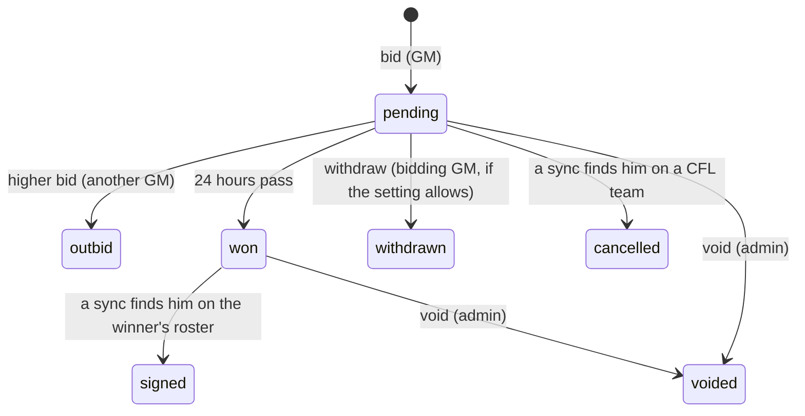

# In-season plan: UFA bids

A plan for running in-season free agent bids in the app instead of in the forum thread. GMs bid on
players who are on no CFL team. The highest bid after 24 hours wins. The add stays in Fantrax, and
the next sync gives the player his contract at the winning bid.

Status: built, milestones 1–5. The app uses the proposed answers to the
[questions](#questions-for-the-league) until the league decides them. Most of them are settings.

## The rules

From [rules.md](rules.md) (In-season Free-agent Acquisitions, Rosters and Playoffs):

- A player on no CFL team is a UFA. A GM gets him with a bid.
- The highest bid for 24 hours wins.
- A GM can't bid beyond the team's cap room.
- The winner gets a 1-year contract that uses no contract-bank years. When it ends, the player
  goes back to the auction as a UFA, at any age.
- Rosters freeze at the end of the regular season. Until the playoffs end, only an active playoff
  team can sign a UFA, and only to replace an injured player.

## What the app does today

GMs bid in the forum thread, and the winner adds the player in Fantrax. The next sync finds a
player who was on no team before, and `mark_pickups` gives him a placeholder contract:

```python
# cfl/contracts.py
PICKUP_SALARY = 1.0   # Fantrax has no bid amounts: a placeholder until the GM sets the winning bid
...
save_override(conn, ctx.league_id, p.fantrax_id, [PICKUP_SALARY], "IN_SEASON_UFA", A.PICKUP_NOTE)
```

Then someone types the winning bid into the contract editor. The `IN_SEASON_UFA` contract type
already follows the rules:

- 1 year only (`contracts.validate`)
- no contract-bank years (`analysis.contract_years`)
- a UFA when it ends (`analysis.contract_end`)

## The bid machine

A UFA bid is an [offer sheet](offseason-plan.md#offer-sheets) without the owner's match. It uses
the same helper, [`cfl/fsm.py`](../cfl/fsm.py).



**Bid.** Any GM can bid on a player who is on no Fantrax team. Guards:

- Bids are open: today is between Fantrax's start and end dates for the season, and the playoffs
  haven't started. The playoffs start with the scoring period that Fantrax's playoff settings
  call `firstPlayoffPeriod`. In the playoffs, the admin can force a bid with a reason, for example
  "replaces the injured X". When the offseason's `league_phase` exists, bids also need the
  `in_season` phase.
- The salary is at least `ufa.min_bid`. It is also at least `ufa.min_raise` more than the pending
  bid, if there is one.
- The team doesn't already hold the pending bid.
- The team has this season's cap space for the salary. Its other pending and won bids count
  against that space, so it can't bid past its room across several players.

Effects: the pending bid on the same player becomes `outbid`, and the new bid's 24 hours start.
The bid stores its deadline.

**Two GMs at once.** When a pending bid exists, only one GM can move it to `outbid`. The other
gets a 409. When no bid exists yet, this index refuses the second insert:

```sql
CREATE UNIQUE INDEX IF NOT EXISTS idx_ufa_bids_pending ON ufa_bids(league_id, player_id) WHERE state = 'pending';
```

SQLite and Postgres both support partial indexes.

**24 hours pass.** The bid moves to `won` and shows on the winner's "Add in Fantrax" list. The
app checks deadlines lazily, as the offseason plan does (see
[Deadlines without a server](offseason-plan.md#deadlines-without-a-server)). Each read of bids, and
each sync, first moves every pending bid past its deadline to `won`, with the actor `deadline`.

**Void** (admin, reason required). This cancels a pending or won bid, for example a bid on the
wrong player. To undo a signed bid, the admin edits the contract as today.

## From a won bid to a contract

The app can't write to Fantrax, because its API is read-only. So the sync connects a won bid to
the Fantrax add. `mark_pickups` changes in two ways:

```python
# cfl/contracts.py, mark_pickups
B.settle(conn, ctx.league_id)
for bid in rows(conn, "SELECT * FROM ufa_bids WHERE league_id=? AND state='won'", (ctx.league_id,)):
    p = ctx.players.get(bid["player_id"])
    if p and p.team_id == bid["team_id"]:
        save_override(conn, ctx.league_id, p.fantrax_id, [bid["salary"]], "IN_SEASON_UFA", B.WON_NOTE)
        B.BIDS.fire(conn, B.key(bid), "sign", "sync")
```

- **A pickup with a won bid** for his new team gets a 1-year contract at the bid's salary, and the
  bid moves to `signed`.
- **A pickup with no won bid** keeps the $1 placeholder, as today. The admin sees him on a list of
  pickups with no winning bid.

The sync also does two more things:

- **A pending bid on a player now on a CFL team** moves to `cancelled`.
- **A won bid whose player is on another team** stays `won`. The admin sees it as a problem, and
  voids the bid or reverses the add in Fantrax.

## Settings

New rules in [`cfl/rules.py`](../cfl/rules.py):

| Setting | Default | Key |
|---|---|---|
| Hours a bid must stand to win | 24 | `ufa.bid_hours` |
| Lowest bid | $1 | `ufa.min_bid` |
| Smallest raise over the pending bid | $1 | `ufa.min_raise` |
| Bids can be withdrawn | no | `ufa.withdraw` |

`ufa.withdraw` needs a new `bool` kind in `KINDS`. The offer sheet toggles need it too. A bid
stores its deadline when a GM makes it, so a change to `ufa.bid_hours` never moves an existing
deadline. No setting needs a lock.

## Data model

```sql
CREATE TABLE IF NOT EXISTS ufa_bids (
    id              TEXT PRIMARY KEY,
    league_id       TEXT NOT NULL,
    season_year     INTEGER NOT NULL,   -- the season the contract is for
    player_id       TEXT NOT NULL,
    team_id         TEXT NOT NULL,      -- the bidding team
    salary          REAL NOT NULL,
    state           TEXT NOT NULL,      -- pending / outbid / won / signed / withdrawn / cancelled / voided
    deadline        TEXT NOT NULL,      -- ufa.bid_hours after the bid
    created_by      TEXT NOT NULL,
    created_at      TEXT NOT NULL
);
```

There are no changes to existing tables. `machine_events` logs every move, with the machine
`ufa_bid`.

## API and UI

Endpoints follow the existing style:

- `GET /ufa-bids`: open bids, won bids not yet added in Fantrax, and this season's results. It
  includes `now`, so countdowns use the server's clock.
- `GET /free-agents?q=…`: players on no CFL team whose names match, for the bid form.
- `GET /ufa-bids/preview?player_id=…&salary=…`: the guard's reasons and the team's cap space after
  the bid. It saves nothing.
- `POST /ufa-bids`: 400 with the guard's reasons, or 409 when a higher bid came first.
- `POST /ufa-bids/{id}/{withdraw|void}`.

Pages:

- **UFA bids** (a new tab for everyone): each open bid with the high bid, its team and the time
  left. Won bids, with what's left to do in Fantrax. Earlier bids this season. Bids are public, as
  forum posts were.
- **New bid** finds a free agent by name. **Raise** on an open bid starts at the lowest bid that
  beats it. The form shows the preview after each pause in typing.
- **Admin,** on the same page: a team to bid for, a reason to allow a refused bid, Void, and the
  pickups with no winning bid.

The bid form uses `useState` and `useMutation`, as the Rules page's form does. The frontend plan's
`offerSheet` machine fits it, but `xstate` isn't a dependency yet. When it is, one machine can serve
both forms.

## Testing

- **Every trigger from every state:** the machine allows it, or refuses it with 409.
- **Guards:** the lowest bid, the raise, the team's own pending bid, and cap space less the team's
  other open bids.
- **Races:** two raises on one pending bid, and two first bids on one player. Exactly one wins each
  race.
- **Lazy deadlines:** move the clock, read, and check that the bid is `won`.
- **Sync:**
  - A pickup with a won bid gets its salary, and the bid moves to `signed`.
  - A pickup with no bid gets the placeholder.
  - A pending bid on a player added elsewhere moves to `cancelled`.
- **Previews:** a preview gives the same reasons as the bid.

## Milestones

Each milestone is one or two small PRs:

1. **Settings.** The `bool` kind and the four `ufa.*` rules.
2. **Bids.** `ufa_bids`, the machine, lazy deadlines, withdraw, void and the endpoints.
3. **Sync.** `mark_pickups` uses the won bid, cancels pending bids, and lists pickups with no bid.
4. **Page.** The UFA bids page, the Bid button and the bid form. After this milestone, the league
   can stop using the forum thread.
5. **Playoffs.** The freeze guard. `league.playoffs`, synced from Fantrax, gives the first playoff
   period (21 in 2026-27, which starts on March 15, 2027), and `periods` gives its start.

## Questions for the league

| Question | Proposed answer |
|---|---|
| Does the app replace the forum thread? | Yes. After milestone 4, GMs bid only in the app. |
| Does each new high bid start its own 24 hours? | Yes. The rule says the highest bid "for 24 hours" wins. |
| What are the lowest bid and the smallest raise? | $1 and $1. |
| Can a GM withdraw a bid? | No, as with offer sheets. |
| Does cap room count a player the GM will release if the bid wins? | No. Room is this season's space now, less the team's other open bids. A GM who needs room releases a player first. |
| Who adds the winner in Fantrax? | The winning GM, as today. |
| Can GMs bid at once on a player that a CFL team released, or must he clear waivers first? | Bids treat every player on no team the same. Waivers stay manual. |
| In the playoffs, which injuries allow a signing? Rosters says Out, DTD or IR. Playoffs says IR only. | Out, DTD or IR. The admin checks the injury when forcing the bid. |

## Not in this plan

- **Prospect claims.** The [offseason plan](offseason-plan.md#not-in-this-plan) made them an
  in-season feature. They need a machine of their own (a claim, then an ELC). A later section of
  this plan can add them.
- **Waiver claims** by priority order.
- **Notifications.** The app sends no message when a GM is outbid.
