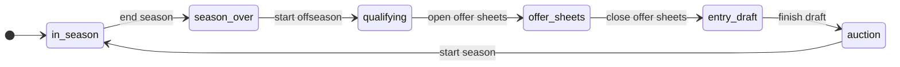
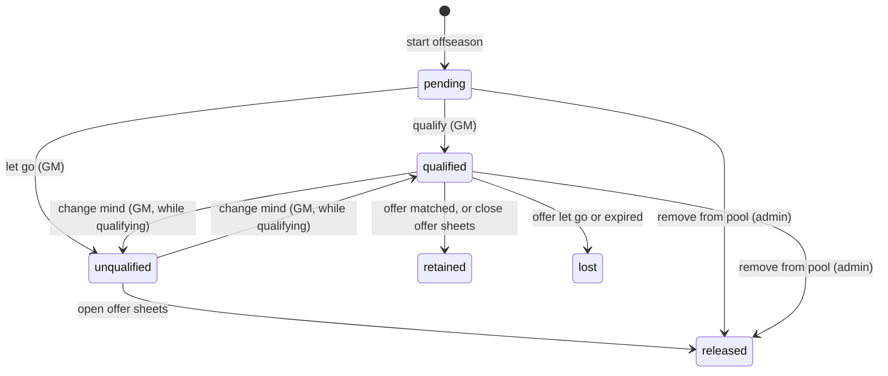
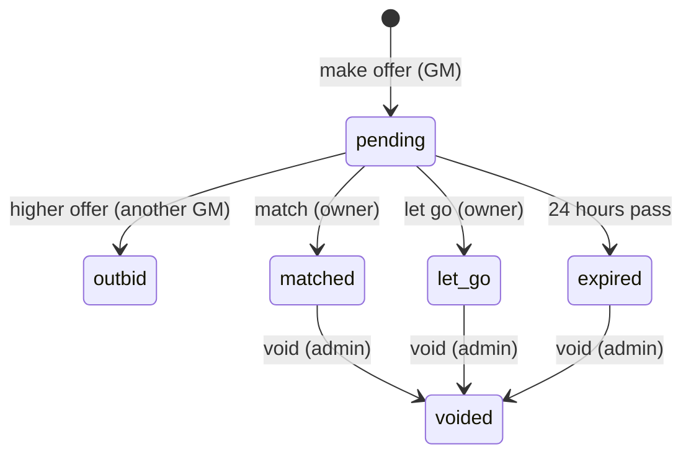
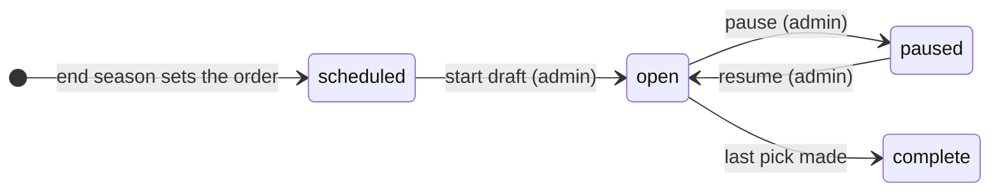

# Offseason plan: phases, RFA offer sheets and the entry draft

A plan for running the CFL offseason in the app instead of on the forum. The admin (the
commissioner) moves the league from one phase to the next explicitly. GMs qualify their RFAs, make
and answer offer sheets, and draft prospects in the app. The free agent auction stays in Fantrax,
and the app imports its results.

Status: draft. Nothing is built yet. The rule questions this plan raised were answered on
October 19, 2026 (see [Decisions](#decisions)). The answers are also in [rules.md](rules.md) under
Clarifications, which the code will cite.

## The year at a glance



| Phase | What happens | Who acts |
|---|---|---|
| `in_season` | Today's app. | — |
| `season_over` | After the playoffs, the admin records the champion. Final standings and the champion fix the draft order. | Admin |
| `qualifying` | Contracts roll over to the next season and UFAs are released. Each GM either qualifies each of their RFAs at his old salary for 1–5 years, or lets him go to the auction. | GMs |
| `offer_sheets` | Unqualified RFAs are released. GMs bid salaries on other teams' qualified RFAs, and a higher bid replaces a lower one. The owner has 24 hours to match. This runs about two weeks in June. | GMs |
| `entry_draft` | The non-snaking entry draft runs on a 24-hour clock. | GMs |
| `auction` | The auction runs in Fantrax. The admin imports the results, and GMs set each purchase's years. | Admin, GMs |

Every arrow is an admin action. The app never moves on by date, because the dates change every
year and the commissioner decides when a phase is done.

## Are state machines a good fit?

Yes. The offseason is made of things that move through a small, fixed set of states, where each
move is allowed only from certain states, under certain conditions, by certain people:

- **The league's phase** (above).
- **An RFA's rights** for one offseason: pending, then qualified or unqualified, then retained,
  lost or released.
- **An offer sheet**: pending, then matched, let go, expired or outbid.
- **The entry draft**, and each pick in it: on the clock, then made or auto-picked.

Writing these as explicit machines gives three things that ad-hoc `if` checks don't. First, one
table answers "can this happen now?" for the API, the UI's buttons and the tests. Second, every
change goes through one place that logs it. Third, two people acting at once can't both win.

### Python options

| Option | What it is | Fit here |
|---|---|---|
| [`transitions`](https://github.com/pytransitions/transitions) | The most widely used library. You list states and transitions as dicts, and it adds trigger methods (`sheet.match()`) to your object at runtime. It has conditions, callbacks, nested machines and Graphviz diagrams. | Mature, but readers and type checkers can't see the methods it adds at runtime. |
| [`python-statemachine`](https://github.com/fgmacedo/python-statemachine) | Declarative classes: `match = pending.to(matched, cond="owner_has_cap_space")`. It has guards, validators, final states and diagrams, and can bind to a model object's state field. | The cleanest library API for this. |
| `django-fsm` | Decorators on Django model fields. | Django only. This app is FastAPI and plain SQL. |
| A small table of our own | A dict of `(state, trigger) → (next state, guard)` plus one `fire()` function that writes the change. | **Recommended.** |

**Recommendation:** model these as state machines, but write the ~50-line helper ourselves rather
than add a library.

- **The libraries don't solve the hard part.** That part is persistence and concurrency. The app
  runs on Vercel, so every request starts cold: it reads the state from Postgres, checks the move
  and writes it back. The libraries keep state in memory. We'd still write the conditional
  `UPDATE`, the transaction and the audit row ourselves, which is most of the code.
- **The machines are small.** Each has 4–7 states, and their transitions come from HTTP actions.
  Their guards are database questions ("has every team decided on its RFAs?"). Nested states,
  async support and callback chains aren't needed.
- **It matches the codebase.** The app has six runtime dependencies and modules like `picks.py`
  that are a hundred lines of plain functions. A table plus a function reads the same way.
- **Timers need our own code either way.** No library helps with deadlines on Vercel (see
  [Deadlines without a server](#deadlines-without-a-server)).

If the machines grow nested states later, `python-statemachine` is the one to switch to. The
tables below port to it directly.

### Sketch

```python
# cfl/fsm.py
@dataclass(frozen=True)
class Transition:
    source: FrozenSet[str]
    dest: str
    # Returns the reasons the move can't happen now; empty means it can.
    guard: Callable[[Connection, Dict[str, Any]], List[str]] = lambda conn, ctx: []
    admin_only: bool = True


class Machine:
    def __init__(self, name: str, table: str, transitions: Dict[str, Transition]): ...

    def available(self, conn, state, ctx) -> Dict[str, List[str]]:
        """Each trigger allowed from this state, with what's stopping it (for the UI's buttons)."""

    def fire(self, conn, key, trigger, actor, ctx, effects=None, force_reason=None) -> str:
        """Move one row from its state by `trigger`, in one transaction:
        1. reject a trigger that isn't allowed from the row's current state (409);
        2. run the guard and refuse if it returns reasons, unless the admin forces it with a reason;
        3. UPDATE <table> SET state=<dest> WHERE <key> AND state=<current>. If no row changed,
           someone else moved it first (409);
        4. run `effects` (release players, write contracts, move picks) in the same transaction;
        5. log the move in machine_events: who, when, from, to, trigger, forced reason, detail."""
```

The conditional `UPDATE` is the concurrency control. It works the same on SQLite and Postgres,
needs no locks, and means two admins clicking "Open offer sheets" at once can't both succeed. It
also settles two GMs bidding on the same RFA at once: only one of them can move the pending offer
to `outbid`.

The same offer sheet machine in `python-statemachine`, for comparison:

```python
class OfferSheet(StateMachine):
    pending = State(initial=True)
    matched = State()
    let_go = State()
    expired = State()
    outbid = State(final=True)
    voided = State(final=True)

    match = pending.to(matched, cond="owner_has_cap_space")
    decline = pending.to(let_go)
    expire = pending.to(expired, cond="past_deadline")
    outbid_by = pending.to(outbid)
    void = matched.to(voided) | let_go.to(voided) | expired.to(voided)


sheet = OfferSheet(model=row, state_field="state")   # row loaded from the database
sheet.send("match")                                  # then we still save row.state ourselves
```

## Foundation

These have to land first, because everything else depends on them.

### Every team's contracts in the app

The rollover moves contracts on a season. That works for contract records kept in the app, which
know which season they started in, but not for salary sheets the app reads. So before June 2027,
every team becomes app-owned the way yours is today. Each team's sheet is copied into the app
once, and after that the app is the source of truth. Publishing back to each team's sheet is
optional: it needs that sheet's Apps Script set up.

### The season contracts are signed for

Today the "current season" is Fantrax's `league.season_year`. Contract records count their seasons
from it ([`current_salaries`](../cfl/sync.py)), and so do the cap outlook, the Offseason list and
the draft years. But the RFA period is in June, before Fantrax renews the league. A qualifying
offer signed in June 2027 is for 2027-28 while Fantrax still says 2026-27. Saved against 2026, it
would read as this season's contract and replace the player's current one.

The fix is a **league year** that the phase machine owns:

- **In `in_season` and `season_over`,** it's the season being played, which is Fantrax's.
- **`start offseason` moves it to the next season,** the one being prepared. That *is* the rule's
  rollover: "the years will roll back at the termination of the season". Contracts that ended run
  out, the cap outlook starts at next season, and new contracts are saved against it.
- **Everywhere the app reads `league.season_year` for contracts,** it reads
  `max(Fantrax season, league year)` instead. Until the admin first ends a season there's no
  phase row, so nothing changes until then.
- **Draft years follow the next draft not yet held,** not the season. During the offseason, until
  the draft is done, the upcoming draft is the one in the new league year. Once it's finished, the
  range moves on a year. (Today `picks.draft_years` adds 1 to the season, which would drop the
  upcoming draft at rollover.)
- **Projections are unaffected.** They follow NHL stat seasons.

`start season` checks that Fantrax now reports the new season too, and warns if not.

### Cap room in the offseason

Next season's $220 cap counts the same players it does during the season: active and bench
salaries plus buyouts, by each player's Fantrax status. IR and minors don't count. The commissioner
can also leave a player out, with a reason, for example one who has gone back to Europe or is
holding out. It's a new `cap_exemptions` record that the cap code skips until the commissioner
removes it. Matching, offering and qualifying all use this one number.

## Phases in detail

Each transition lists its guard and its effects. The guard says what must be true; the admin can
force past it with a reason unless it says otherwise. The effects say what the transition does,
in the same transaction.

### End season (`in_season → season_over`)

- **Guard:** the season is over (Fantrax's end date has passed).
- **Effects:** the admin picks the playoff champion. The app saves the final regular-season
  standings and the champion as the draft order: reverse standings, champion last in every round.
  The draft order can be edited until the draft starts.

### Start offseason (`season_over → qualifying`)

- **Guard:**
  - Every team's contracts are in the app.
  - Every expiring player has a known status. Today that means no rostered player whose contract
    ends this season lacks a birth date; the Offseason list already shows these.
  - Rostered players with no contract on file are listed as a warning.
- **Preview:** before confirming, the admin sees exactly who will be released and who becomes a
  pending RFA, by team. It's the existing Offseason list.
- **Effects:**
  - The league year moves on (see above).
  - An `offseason_players` row is written for every player whose contract ran out:
    - **UFAs** (27 or older on July 1, or in-season pickups) are released.
    - **RFAs** are pending, with their final salary as the qualifying amount.
  - Released players go on the [Fantrax to-do list](#what-the-commissioner-mirrors-in-fantrax),
    so they're in the auction pool.

### Open offer sheets (`qualifying → offer_sheets`)

- **Guard:** every RFA has a decision. This one can't be forced. If a GM doesn't answer, the
  commissioner decides for that team. Admins can act for any team, as they can already edit any
  team's contracts.
- **Effects:**
  - Unqualified RFAs are released to the auction pool.
  - Qualified RFAs get their contract now, at the old salary for the years the GM chose, with
    origin `RFA_QO`. Saving it now means the existing cap and contract-bank code counts it while
    teams weigh offer sheets, with nothing new to compute.

### Close offer sheets (`offer_sheets → entry_draft`)

- **Guard:** no offer sheet is still pending. The guard first runs the lazy deadline check, so one
  whose 24 hours have passed counts as decided.
- **Effects:**
  - Qualified RFAs nobody took are marked retained. Their QO contracts already exist.
  - The admin sets the deadline for picking years on this summer's offer sheet signings.

### Finish draft (`entry_draft → auction`)

- **Guard:** the draft is complete. Alternatively, the admin skips it because it was run elsewhere
  (for example on the forum the first year) and records the picks by hand.
- **Effects:** none beyond the draft's own.

### Start season (`auction → in_season`)

- **Guard:**
  - The auction is imported, and its years deadline has passed.
  - Fantrax reports the new season (warning only).
- **Effects:** the phase returns to `in_season`, and the league year is now Fantrax's again.

### Going back

Mistakes happen, so the admin can step back one phase, but **only while the phase has no side
effects yet**: back to `qualifying` if no offer sheet has been made, back to `offer_sheets` if no
pick has been made. Anything else is undone at the level of the thing that went wrong: void an
offer sheet, undo a draft pick, or edit a contract as today.

## RFAs and offer sheets

### The rules

The written rules say an RFA can be qualified "for the same amount as the previous contract".
Other GMs can make offer sheets, which "may be matched at the owning GM's decision, provided they
have space within the salary cap". The signing team sends draft picks "in a similar style to the
NHL". The October 2026 clarifications in [rules.md](rules.md) fill in the rest:

- **Every RFA gets a decision.** The GM qualifies him at his old salary for 1–5 years, or lets him
  go to the auction as a UFA.
- **An offer sheet is a salary, nothing more.** It must be more than the qualifying salary.
  Whichever team ends up with the player picks his years afterwards (1–5, within its contract
  bank), by a deadline the commissioner sets. If a team misses it, the contract is 1 year.
- **A higher salary replaces a pending offer** and restarts the owner's 24 hours. Offers can't be
  withdrawn.
- **The owner has 24 hours** to match. No answer means the player goes.
- **The offering team needs room:** next season's cap space for the salary, room in its contract
  bank, and the compensation picks in the upcoming draft.
- **Compensation follows the offer's salary.** The ladder below was fit to the 2024–26 offer sheets
  in the CFL Contracts sheet, which it reproduces:

  | Offer salary | The signing team sends |
  |---|---|
  | under $10 | nothing |
  | $10 | a 4th |
  | $11–$18 | a 3rd |
  | $19–$25 | a 2nd |
  | $26–$33 | a 1st and a 3rd |
  | $34 and up | a 1st and a 2nd |

  In code it's a table, like `PICK_ROUNDS`:

  ```python
  # Offer sheet compensation (rules.md, Clarifications): the lowest salary of each step, and the
  # rounds of the upcoming draft the signing team sends.
  RFA_COMPENSATION = [(34, (1, 2)), (26, (1, 3)), (19, (2,)), (11, (3,)), (10, (4,)), (0, ())]
  ```

### RFA rights



- **Qualify:** the GM picks 1–5 years. Guard: the years fit the team's contract bank of 50 and
  the salary fits next season's cap.
- **Remove from pool:** the commissioner's escape hatch, for a case like the September 2026 ruling
  that took a player out of the 2026 RFA pool. A reason is required.

### Offer sheets



**Make offer.** Any GM can make one for another team's qualified RFA while the phase is
`offer_sheets`. Guards:

- The salary is more than the qualifying salary, and more than the pending offer's, if there is
  one.
- The offering team owns the picks the ladder asks for, in the upcoming draft. Picks promised by
  its other pending offers are taken, so the same pick can't back two offers.
- The offering team has next season's cap space for the salary and at least one contract-bank
  year. Its other pending offers count against both, so it can't bid past its room across several
  players.

Effects: a pending offer on the same player becomes `outbid`, and the new one's 24 hours start.
The form shows the compensation and the cap and bank impact before submitting. Offers are public,
as posts in the forum thread were.

**Match** (the owning GM). Guard: the owner has cap space for the offer's salary, net of the QO
salary already counted ("provided they have space within the salary cap"). Effects:

- The player's contract takes the offer's salary, origin `RFA_OFFERSHEET`. It keeps the QO's
  years, which the owner can change until the years deadline.
- The RFA is retained.

**Let go, or 24 hours pass.** Effects:

- The player's contract moves to the offering team at the offer's salary for 1 year, origin
  `RFA_OFFERSHEET`. That GM can change the years until the deadline.
- The compensation picks move through the existing `picks.move(kind="rfa")`, and the offer sheet
  keeps the deal id.
- The RFA is lost, and the move goes on the Fantrax to-do list.

**Void** (admin, reason required). This undoes a decided offer sheet. It restores the player's QO
contract and team, and undoes the pick deal with `picks.undo`. That's refused once those picks
have moved again, as today.

Every contract change goes through the existing change log, with "RFA offer sheet" as its source,
so it shows on the Changes tab.

### Where contracts came from

The rules treat contracts differently by how they were signed:

- Only auction signings (and their RFA renewals) earn RFA status. In-season pickups don't.
- A $4+ auction purchase must be bought out.
- A drafted player who got an RFA raise can be released for free.

The app records only `STANDARD`, `ELC` and `IN_SEASON_UFA` today. Add the origins the CFL
Contracts sheet already uses: `AUCTION`, `RFA_QO` and `RFA_OFFERSHEET`. The offseason flows write
them, and `reconcile-contracts` can import them from the sheet's Type column. It's a small change
that the buyout and release rules can use later.

## Entry draft



- **Order:** set at `end season` from the final standings and the champion. It's non-snaking, with
  the champion last in each round. The 5 rounds come from `PICK_ROUNDS`, and each slot's owner
  comes from pick ownership (`picks.py`), so traded and compensation picks are already in place.
- **Eligibility:** any player who isn't held by a CFL team and has never been signed in the CFL.
  The app knows the contracts it has on file, and the CFL Contracts sheet's history fills the gaps.
- **Each pick is on the clock for 24 hours.** The team on the clock picks any eligible player.
  When the clock runs out, the app picks for them: from the team's pre-submitted list if they sent
  one, or else the player taken earliest in this year's NHL draft who is still available (from
  NHL.com's draft results).
- **Admin controls:** pause and resume, undo the last pick, make a pick for a team.
- **Fantrax:** each pick goes on the to-do list, so the commissioner adds the player to that
  team's minors.

## Free agent auction

The auction runs in Fantrax as now. The app imports the results:

- **Import.** The Fantrax draft results give each purchase's team, player and price. Fantrax's
  public API has a draft-results endpoint, but we still need to confirm it returns auction prices.
  The import is repeatable and idempotent, so the admin can run it during and after the auction.
- **Years.** Fantrax doesn't record contract lengths; they've been posted on the forum. Each GM sets
  the years of each purchase (1–5) in the app, within the contract bank, by the commissioner's
  deadline. Purchases are saved for 1 year with origin `AUCTION` until the GM changes them.

## What the commissioner mirrors in Fantrax

The app reads Fantrax but can't write to it, since its public API is read-only. So each
roster-changing effect adds an item to a **Fantrax to-do list** on the admin's Offseason page:

- drop a released UFA or unqualified RFA;
- move a lost RFA to the team that signed him;
- add a draftee to a team's minors.

The next roster sync ticks off the items Fantrax now reflects. Until then, the app shows the
offseason's rosters, not Fantrax's.

## Deadlines without a server

Vercel runs the app only when a request comes in, and its Hobby plan runs cron jobs at most once a
day. So the app checks its deadlines **lazily**:

- an offer sheet's 24 hours;
- a draft pick's 24-hour clock;
- the years deadlines for offer sheet signings and auction purchases.

Every read or write that depends on a deadline first applies any that has passed. It fires the
`expire` or `auto_pick` transition, or closes the years, through the same `fire()`, so it's
logged and safe to race. A daily Vercel cron calls the same check as a backstop, for quiet
stretches.

The deadline is stored on the row, so its effect is the same whenever the check runs. A pick made
automatically at 3:00 for a clock that ran out at 1:00 is still the pick the rules would give.

## Data model

New tables, following `db.py`'s conventions (written once for SQLite and Postgres, keyed by
`league_id`):

```sql
-- Where the league is in its year. No row: in season, as today.
CREATE TABLE league_phase (
    league_id       TEXT PRIMARY KEY,
    season_year     INTEGER NOT NULL,   -- the league year (see "Foundation")
    phase           TEXT NOT NULL,      -- in_season / season_over / qualifying / offer_sheets / entry_draft / auction
    years_due_at    TEXT,               -- the current years deadline (offer sheet signings, then auction buys)
    changed_at      TEXT NOT NULL,
    changed_by      TEXT NOT NULL
);

-- Every state change of every machine: the audit trail, and the source for an offseason history view.
CREATE TABLE machine_events (
    id              INTEGER PRIMARY KEY AUTOINCREMENT,
    league_id       TEXT NOT NULL,
    machine         TEXT NOT NULL,      -- phase / rfa / offer_sheet / draft / draft_pick
    entity_id       TEXT NOT NULL,
    trigger         TEXT NOT NULL,
    from_state      TEXT,
    to_state        TEXT NOT NULL,
    actor           TEXT NOT NULL,      -- who, or "deadline"
    forced_reason   TEXT,               -- set when the admin overrode a guard
    detail          TEXT,               -- JSON
    at              TEXT NOT NULL
);

-- Each offseason's free agents: every contract that ran out when the season ended.
CREATE TABLE offseason_players (
    league_id       TEXT NOT NULL,
    year            INTEGER NOT NULL,   -- the offseason (July 1 of this year decides UFA/RFA)
    player_id       TEXT NOT NULL,
    team_id         TEXT NOT NULL,      -- whose contract ran out (holds his RFA rights)
    status          TEXT NOT NULL,      -- UFA / RFA
    qualifying_salary REAL,             -- RFAs: the final season's salary
    qualifying_years INTEGER,           -- set when qualified
    state           TEXT NOT NULL,      -- released / pending / qualified / unqualified / retained / lost
    PRIMARY KEY (league_id, year, player_id)
);

CREATE TABLE offer_sheets (
    id              TEXT PRIMARY KEY,
    league_id       TEXT NOT NULL,
    year            INTEGER NOT NULL,
    player_id       TEXT NOT NULL,
    from_team_id    TEXT NOT NULL,      -- the team making the offer
    to_team_id      TEXT NOT NULL,      -- the team holding his rights
    salary          REAL NOT NULL,      -- an offer is a salary only; the years come after
    compensation    TEXT NOT NULL,      -- JSON: the picks the ladder required, fixed when made
    state           TEXT NOT NULL,      -- pending / outbid / matched / let_go / expired / voided
    deadline        TEXT NOT NULL,      -- 24 hours after it was made
    pick_deal_id    TEXT,               -- the pick_moves deal, once picks moved
    created_by      TEXT NOT NULL,
    created_at      TEXT NOT NULL
);

-- Players the commissioner leaves out of the cap (back in Europe, holding out). Until removed.
CREATE TABLE cap_exemptions (
    league_id       TEXT NOT NULL,
    player_id       TEXT NOT NULL,
    reason          TEXT NOT NULL,
    set_by          TEXT NOT NULL,
    set_at          TEXT NOT NULL,
    PRIMARY KEY (league_id, player_id)
);

CREATE TABLE drafts (
    league_id       TEXT NOT NULL,
    year            INTEGER NOT NULL,
    state           TEXT NOT NULL,      -- scheduled / open / paused / complete
    order_json      TEXT NOT NULL,      -- team ids, first pick to last, in every round
    PRIMARY KEY (league_id, year)
);

CREATE TABLE draft_picks (
    league_id       TEXT NOT NULL,
    year            INTEGER NOT NULL,
    overall         INTEGER NOT NULL,
    round           INTEGER NOT NULL,
    original_team_id TEXT NOT NULL,
    team_id         TEXT NOT NULL,      -- who picks (the pick's owner when the draft started)
    state           TEXT NOT NULL,      -- waiting / on_clock / made / auto
    clock_ends_at   TEXT,
    player_id       TEXT,
    made_by         TEXT,
    made_at         TEXT,
    PRIMARY KEY (league_id, year, overall)
);

CREATE TABLE draft_lists (            -- a GM's pre-submitted picks, best first
    league_id       TEXT NOT NULL,
    year            INTEGER NOT NULL,
    team_id         TEXT NOT NULL,
    player_ids      TEXT NOT NULL,      -- JSON list
    PRIMARY KEY (league_id, year, team_id)
);
```

There's one change to existing tables: `contract_overrides.contract_type` gains `AUCTION`,
`RFA_QO` and `RFA_OFFERSHEET`. Contracts written by the offseason flows are ordinary app contract
records (`contract_overrides`, with `season_year` set to the league year). So the cap, the Players
& cap tab, sheet publishing and the change log all pick them up unchanged. Setting the years uses
the existing contract editor; the deadline only stops changes and keeps 1 year for anything left
unset.

## API and UI

The **Offseason** tab is admin-only today. During the offseason it becomes everyone's hub,
showing what's relevant to the current phase:

- **Everyone:** a phase banner with what's happening and what's next.
- **Qualifying:** your RFAs, each with Qualify (pick years) or Let go, and the cap and bank
  impact. Other teams' decisions show once the phase closes.
- **Offer sheets:**
  - **RFA market:** every qualified RFA on other teams, with a Make offer form. It shows the
    current high offer, the compensation, and your cap and bank afterwards.
  - **Your RFAs:** offers on them, with Match or Let go and the time left.
  - **Every offer:** the public thread.
  - **Your signings:** players you've won or matched, each with years to set before the deadline.
- **Draft:** the board, who's on the clock and the time left, your pick form and your list.
- **Auction:** your purchases, each with years to set.
- **Admin:**
  - The next transition's button, with its guard's unmet items listed ("3 teams haven't decided
    on 5 RFAs"), and Force with a reason where allowed.
  - The Fantrax to-do list.
  - Cap exemptions.
  - Remove from pool, void, and the draft controls.

Endpoints follow the existing style:

- `GET /offseason/state`: the phase, with the allowed transitions and their blockers for this
  user.
- `POST /offseason/transitions/{trigger}`: admin.
- `PUT /offseason/rfas/{player_id}`: qualify or let go.
- `POST /offer-sheets`, then `POST /offer-sheets/{id}/{match|let-go|void}`.
- `PUT` / `DELETE /cap-exemptions/{player_id}`: admin.
- `GET /draft`, `POST /draft/picks`, `PUT /draft/list`.
- `POST /auction/import`.

Each check runs in the API, not just in the page: 409 for a wrong state, 403 for a wrong person,
and 400 with the guard's reasons.

## Testing

Machines make good tests:

- **Every trigger from every state.** For each machine, a table-driven test checks that each
  trigger is either allowed or refused with 409.
- **Guards and effects** get the usual unit tests on a seeded database, as `tests/test_core.py`
  does now.
- **Races.** Two `fire()` calls from the same state, for example two GMs outbidding the same
  offer at once: exactly one wins.
- **Lazy deadlines.** Move the clock, read, and check the expiry, the auto-pick, or the 1-year
  default.

## Milestones

The next offseason starts in June 2027 (the regular season ends in the spring), so there's time to
build this in order and try each piece on a copy of the data:

0. **Every team in the app.** Adopt each team's sheet once, as app-owned teams are today.
1. **Foundation.**
   - `fsm.py`, `league_phase` and `machine_events`.
   - The league year, and draft years following the next draft.
   - Cap exemptions and the new contract origins.
   - `end season` and `start offseason`, with their preview and the Fantrax to-do list.

   On its own, this replaces the commissioner's manual UFA release and RFA list.
2. **Qualifying.** RFA decisions and `open offer sheets`.
3. **Offer sheets.**
   - The compensation ladder.
   - Making, outbidding, matching and letting go.
   - The 24-hour clock, voiding, the years deadline, and `close offer sheets`.
4. **Entry draft.** Order, clock, picks, lists, auto-pick and lazy timeouts.
5. **Auction import.** Fantrax results, years, and `start season`.

Milestones 0–3 are what's needed for June 2027. The draft and auction can stay manual a year
longer, using the skip transitions.

## Decisions

Answered on October 19, 2026, and written into [rules.md](rules.md):

| Question | Decision |
|---|---|
| Compensation | The ladder above, fit to 2024–26 history. |
| Several offers for one RFA | A higher salary replaces the pending offer and restarts the owner's clock. |
| What an offer contains | A salary only. Whichever team ends up with the player picks his years afterwards. |
| Lowest offer | More than the qualifying salary. |
| Match window | 24 hours. No answer means the player goes. |
| Withdrawing an offer | Not allowed. |
| Room to make an offer | Cap space and contract-bank years, plus the compensation picks. |
| Which picks | The upcoming entry draft's. The signing team must own them. |
| Qualifying offer length | The GM picks 1–5 years. |
| Undecided RFAs | Not allowed. Every RFA is decided before offer sheets open. |
| Years deadline | The commissioner sets one. Anything left unset is 1 year. |
| Offseason cap | Counted as in season, with commissioner exemptions per player. |
| End season vs start offseason | Separate actions. |
| Draft pool | Anyone not held by a CFL team and never signed in the CFL. |
| Auto-pick | The player taken earliest in this year's NHL draft who is still available. |
| Contracts | Every team's contracts move into the app before June 2027. |
| Prospects | No offseason step. GMs may leave eligible prospects unsigned. |

### Not in this plan

- **Prospect claims.** Once an unsigned prospect plays the game that crosses the threshold (120
  games, or 60 for goalies) and isn't on his team's roster, a rival GM can claim him and sign him
  to an ELC. That happens during the regular season, so it's a separate in-season feature.
- **An automatic raise for qualified RFAs** based on how they rank. That would be a rule change;
  it's noted in rules.md as an idea.

### Still open

- **Unsigned prospects at 27.** The CFL Contracts sheet releases unsigned prospects to the UFA pool
  once they're 27 on July 1. Should `start offseason` do that too?
- **When auto-pick runs out.** If no one from this year's NHL draft class is left, should the
  commissioner make the pick?
- **Auction prices.** We need to check that Fantrax's draft results include them (a technical
  check, not a rule).
