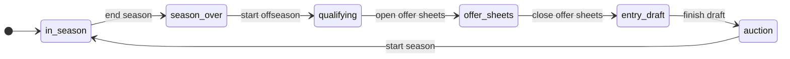
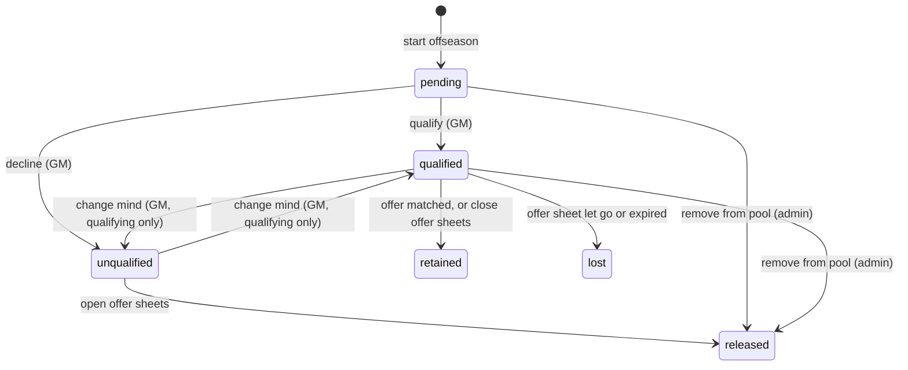
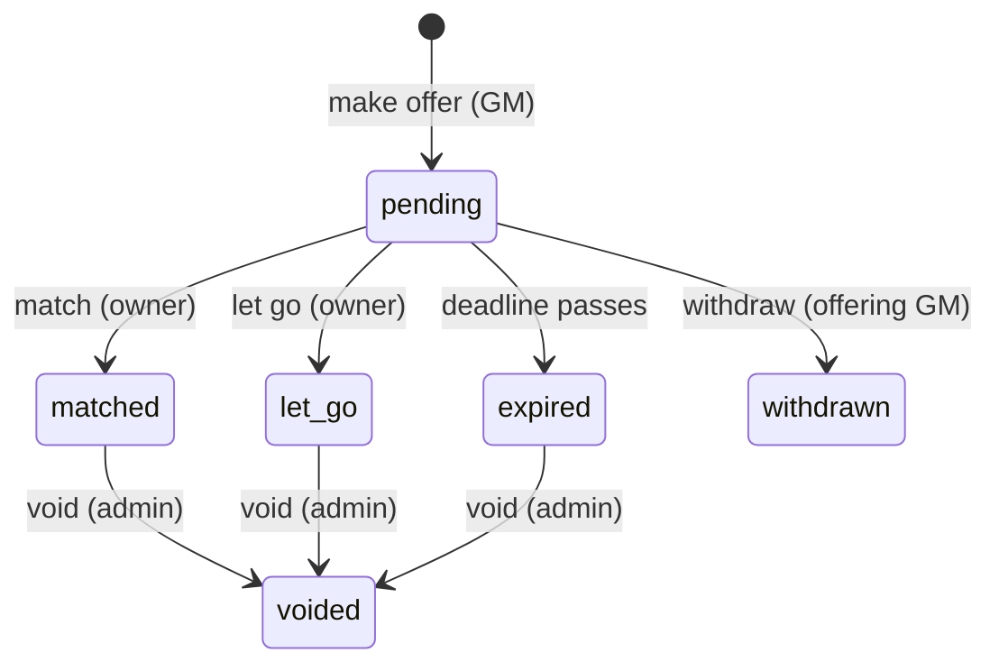
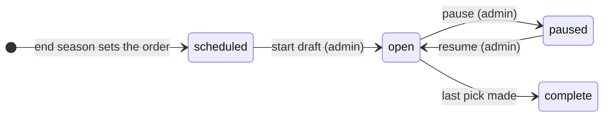

# Offseason plan: phases, RFA offer sheets and the entry draft

A plan for running the CFL offseason in the app instead of on the forum. The admin (the
commissioner) moves the league from one phase to the next explicitly. GMs qualify their RFAs, make
and answer offer sheets, and draft prospects in the app. The free agent auction stays in Fantrax,
and the app imports its results.

Status: draft for discussion. Nothing here is built yet. The rules are in [rules.md](rules.md);
[Open questions](#open-questions) lists what they leave out.

## The year at a glance



| Phase | What happens | Who acts |
|---|---|---|
| `in_season` | Today's app. | — |
| `season_over` | The admin records the champion. Final standings and the champion fix the draft order. Rosters are frozen. | Admin |
| `qualifying` | Contracts roll over to the next season. UFAs are released. Each GM qualifies or releases each of their RFAs. | GMs |
| `offer_sheets` | Unqualified RFAs are released. GMs make offer sheets for other teams' qualified RFAs, and owners match or let go. About two weeks in June. | GMs |
| `entry_draft` | Qualified RFAs with no successful offer sheet sign their qualifying offer. The non-snaking entry draft runs on a 24-hour clock. | GMs |
| `auction` | The auction runs in Fantrax. The admin imports the results; GMs set each purchase's length. | Admin, GMs |

Every arrow is an admin action. The app never moves on by date, because the dates change every
year and the commissioner decides when a phase is done.

## Are state machines a good fit?

Yes. The offseason is made of things that move through a small, fixed set of states, where each
move is allowed only from certain states, under certain conditions, by certain people:

- **The league's phase** (above).
- **An RFA's rights** for one offseason: pending, qualified or unqualified, then retained, lost or
  released.
- **An offer sheet**: pending, then matched, let go, withdrawn or expired.
- **The entry draft**, and each pick in it: on the clock, then made or auto-picked.

Writing these as explicit machines gives three things that ad-hoc `if` checks don't. First, one
table answers "can this happen now?" for the API, the UI's buttons and the tests. Second, every
change goes through one place that logs it. Third, two people acting at once can't both win.

### Python options

| Option | What it is | Fit here |
|---|---|---|
| [`transitions`](https://github.com/pytransitions/transitions) | The most widely used library. You list states and transitions as dicts, and it adds trigger methods (`sheet.match()`) to your object at runtime. It has conditions, callbacks, nested machines and Graphviz diagrams. | Mature, but the methods it adds at runtime are invisible to readers and type checkers. |
| [`python-statemachine`](https://github.com/fgmacedo/python-statemachine) | Declarative classes: `match = pending.to(matched, cond="owner_has_cap_space")`. It has guards, validators, final states and diagrams. It can bind to a model object's state field. | The cleanest library API for this. |
| `django-fsm` | Decorators on Django model fields. | Django only. This app is FastAPI and plain SQL. |
| A small table of our own | A dict of `(state, trigger) → (next state, guard)` plus one `fire()` function that writes the change. | **Recommended.** |

**Recommendation: model these as state machines, but write the ~50-line helper ourselves rather than
add a library.**

- **The libraries don't solve the hard part.** Here that's persistence and concurrency. The app runs on Vercel, so
  every request starts cold: it reads the state from Postgres, checks the move and writes it back.
  The libraries keep state in memory. We'd still write the conditional `UPDATE`, the transaction
  and the audit row ourselves, which is most of the code.
- **The machines are small.** Each has 4–7 states, and their transitions come from HTTP actions. Their guards are
  database questions ("has every team decided on its RFAs?"). Nested states, async support and
  callback chains aren't needed.
- **It matches the codebase.** The app has six runtime dependencies and modules like `picks.py`
  that are a hundred lines of plain functions. A table plus a function reads the same way.
- **Timers need our own code either way.** No library helps with deadlines on Vercel (see
  [Deadlines without a server](#deadlines-without-a-server)).

If the machines grow nested states later, `python-statemachine` is the one to switch to. The
tables below port to it directly.

### Sketch

```python
# cfl/fsm.py
@dataclass(frozen=True)
class Transition:
    source: FrozenSet[str]
    dest: str
    # Returns the reasons the move can't happen now; empty means it can.
    guard: Callable[[Connection, Dict[str, Any]], List[str]] = lambda conn, ctx: []
    admin_only: bool = True


class Machine:
    def __init__(self, name: str, table: str, transitions: Dict[str, Transition]): ...

    def available(self, conn, state, ctx) -> Dict[str, List[str]]:
        """Each trigger allowed from this state, with what's stopping it (for the UI's buttons)."""

    def fire(self, conn, key, trigger, actor, ctx, effects=None, force_reason=None) -> str:
        """Move one row from its state by `trigger`, in one transaction:
        1. reject a trigger that isn't allowed from the row's current state (409);
        2. run the guard, and refuse if it has reasons, unless the admin forces it with a reason;
        3. UPDATE <table> SET state=<dest> WHERE <key> AND state=<current>. If no row changed,
           someone else moved it first (409);
        4. run `effects` (release players, write contracts, move picks) in the same transaction;
        5. log the move in machine_events: who, when, from, to, trigger, forced reason, detail."""
```

The conditional `UPDATE` is the concurrency control. It works the same on SQLite and Postgres,
needs no locks, and means two admins clicking "Open offer sheets" at once can't both succeed.

The same offer sheet machine in `python-statemachine`, for comparison:

```python
class OfferSheet(StateMachine):
    pending = State(initial=True)
    matched = State()
    let_go = State()
    expired = State()
    withdrawn = State(final=True)
    voided = State(final=True)

    match = pending.to(matched, cond="owner_has_cap_space")
    decline = pending.to(let_go)
    expire = pending.to(expired, cond="past_deadline")
    withdraw = pending.to(withdrawn)
    void = matched.to(voided) | let_go.to(voided) | expired.to(voided)


sheet = OfferSheet(model=row, state_field="state")   # row loaded from the database
sheet.send("match")                                  # then we still save row.state ourselves
```

## Foundation: the season contracts are signed for

This has to land first, because everything else depends on it.

Today the "current season" is Fantrax's `league.season_year`. Contract records count their seasons
from it ([`current_salaries`](../cfl/sync.py)), and so do the cap outlook, the Offseason list and
the draft years. But the RFA period is in June, before Fantrax renews the league. A
qualifying offer signed in June 2027 is for 2027-28 while Fantrax still says 2026-27. Saved
against 2026, it would read as this season's contract and replace the player's current one.

Fix: the phase machine owns a **league year**.

- In `in_season` and `season_over` it's the season being played, which is Fantrax's.
- `start offseason` moves it to the next season: the one being prepared. That *is* the rule's
  rollover: "the years will roll back at the termination of the season". Contracts that ended run
  out, the cap outlook starts at next season, and new contracts are saved against it.
- Everywhere the app reads `league.season_year` for contracts, it reads
  `max(Fantrax season, league year)` instead. Until the admin first ends a season there's no
  phase row, so nothing changes until then.
- **Draft years** follow the next draft not yet held, not the season. During the offseason
  before the draft, the upcoming draft is the one in the new league year. Once it's finished, the
  range moves on a year. (Today `picks.draft_years` adds 1 to the season, which would drop the
  upcoming draft at rollover.)
- **Projections are unaffected.** They follow NHL stat seasons.

`start season` checks that Fantrax now reports the new season too, and warns if not.

## Phases in detail

Each transition lists its guard (what must be true; the admin can force past it with a reason)
and its effects (what it does, in the same transaction).

### End season (`in_season → season_over`)

- **Guard:** the regular season is over (Fantrax's end date has passed).
- **Effects:** the admin picks the playoff champion. The app saves the final regular-season
  standings and the champion as the draft order: reverse standings, champion last in every round.
  The draft order can be edited until the draft starts.

### Start offseason (`season_over → qualifying`)

- **Guard:** every expiring player has a known status. Today that means no rostered player whose
  contract ends this season lacks a birth date (the Offseason list already shows these). Rostered
  players with no contract on file are listed as a warning.
- **Preview:** before confirming, the admin sees exactly who will be released and who becomes a
  pending RFA, by team. It's the existing Offseason list.
- **Effects:**
  - The league year moves on (above).
  - An `offseason_players` row is written for every player whose contract ran out:
    - **UFAs**: 27 or older on July 1, or in-season pickups. They're released.
    - **RFAs**: they're pending, with their final salary as the qualifying amount.
  - Released players go on the [Fantrax to-do list](#what-the-commissioner-mirrors-in-fantrax),
    so they're in the auction pool.

### Open offer sheets (`qualifying → offer_sheets`)

- **Guard:** every pending RFA has a decision. Undecided ones are listed by team, and the admin
  can force through with a default ([open question 6](#open-questions)).
- **Effects:**
  - Unqualified RFAs are released.
  - Qualified RFAs get their contract now, at the qualifying salary for the length the GM chose,
    with origin `RFA_QO`. Saving it now means the existing cap and contract-bank code counts it
    while teams weigh offer sheets, with nothing new to compute.

### Close offer sheets (`offer_sheets → entry_draft`)

- **Guard:** no offer sheet is still pending. The guard first runs the lazy deadline check, so an
  expired one counts as decided.
- **Effects:** qualified RFAs nobody took are marked retained. Their QO contracts already exist.

### Finish draft (`entry_draft → auction`)

- **Guard:** the draft is complete. Or the admin skips it because it was run elsewhere (e.g. on
  the forum the first year), and records the picks by hand.
- **Effects:** none beyond the draft's own.

### Start season (`auction → in_season`)

- **Guard:** the auction is imported and every purchase has a length. Fantrax reports the new
  season (warning only).
- **Effects:** the phase returns to `in_season`. The league year is now Fantrax's again.

### Going back

Mistakes happen, so the admin can step back one phase **only while the phase has no side effects
yet**: back to `qualifying` if no offer sheet has been made, back to `offer_sheets` if no pick has
been made. Anything else is undone at the level of the thing that went wrong: void an offer
sheet, undo a draft pick, or edit a contract as today.

## RFAs and offer sheets

### What the rules say, and what the league has done

From the rules: an RFA can be qualified "for the same amount as the previous contract". Other GMs
can make offer sheets, which "may be matched at the owning GM's decision, provided they have
space within the salary cap". The signing team sends draft picks "in a similar style to the NHL".

The CFL Contracts sheet records 2024–26 practice:

- **Qualifying offers run 1 to 5 years.** Lengths seen include `$24 x 1`, `$16 x 3` and `$3 x 5`.
  So the owning GM chooses the length.
- **A matched offer sheet keeps its terms.** For example, "$19 x 5 … Kevin $19 offersheet
  matched" means the owner kept the player at the offer's salary and length.
- **Compensation follows the offer's salary, not its length.** The losing team received:

  | Offer salary | Picks received | Seen |
  |---|---|---|
  | $10 | a 4th | 3 times (2, 3 and 4 years) |
  | $11 | a 3rd | once |
  | $19 | a 2nd | once |
  | $26, $29 | a 1st and a 3rd | twice |
  | $34 | a 1st and a 2nd | once |

  That looks like an NHL-style ladder, but the thresholds between these points aren't known, and
  neither is what offers under $10 cost. The app will keep the ladder as a table in code, like
  `PICK_ROUNDS`, once the commissioner confirms it ([open question 1](#open-questions)).

### RFA rights



- **Qualify:** the GM picks a length of 1–5 years. Guard: the length fits the team's contract
  bank of 50. The salary is fixed by the rules.
- **Remove from pool:** the commissioner's escape hatch, for a case like the September 2026
  ruling that took a player out of the 2026 RFA pool. Reason required.

### Offer sheets



**Make offer** (any GM, for another team's qualified RFA, while the phase is `offer_sheets`).
Guards:

- The player is qualified and has no other pending offer ([open question 2](#open-questions)).
- 1–5 years, at a salary above the qualifying offer ([open question 3](#open-questions)).
- The offering team owns the picks the ladder asks for, in the upcoming draft
  ([open question 1](#open-questions)).
- The offering team has the cap space and contract-bank years for it
  ([open question 7](#open-questions)).

The form shows the compensation and the cap and bank impact before submitting. Offers are public,
like posts in the forum thread were. The deadline is set from a configurable match window
([open question 4](#open-questions)).

**Match** (the owning GM). Guard: the owner has cap space for the offer's salary, net of the QO
salary already counted ("provided they have space within the salary cap"). Effects: the
player's contract is replaced with the offer's terms, origin `RFA_OFFERSHEET`, and the RFA is
retained.

**Let go, or expire.** Effects:

- The player's contract moves to the offering team at the offer's terms, origin
  `RFA_OFFERSHEET`, and the RFA is lost.
- The compensation picks move through the existing `picks.move(kind="rfa")`. The offer sheet keeps
  the deal id.
- The move goes on the Fantrax to-do list.

**Withdraw.** The offering GM can pull a pending offer ([open question 4](#open-questions)).

**Void** (admin, reason required). This undoes a decided offer sheet: it restores the player's QO
contract and team, and undoes the pick deal with `picks.undo`. That's refused once those picks have
moved again, as today.

Every contract change goes through the existing change log, with "RFA offer sheet" as its source,
so it shows on the Changes tab.

### Where contracts came from

The rules treat contracts differently by how they were signed:

- Only auction signings (and their RFA renewals) earn RFA status. In-season pickups don't.
- A $4+ auction purchase must be bought out.
- A drafted player who got an RFA raise can be released free.

The app records only `STANDARD`, `ELC` and `IN_SEASON_UFA` today. Add the origins the CFL
Contracts sheet already uses: `AUCTION`, `RFA_QO` and `RFA_OFFERSHEET`. The offseason flows write
them, and `reconcile-contracts` can import them from the sheet's Type column. It's a small
change that the buyout and release rules can use later.

## Entry draft



- **Order:** set at `end season` from the final standings and the champion. It's non-snaking,
  with the champion last in each round. The 5 rounds come from `PICK_ROUNDS`, and each slot's owner
  comes from pick ownership (`picks.py`), so traded and compensation picks are already in place.
- **Each pick is on the clock for 24 hours.** The team on the clock picks any eligible player.
  When the clock runs out, the app picks for them: from the team's pre-submitted list if they
  sent one, else the highest-ranked available player from this year's NHL draft
  ([open question 10](#open-questions)).
- **Eligibility:** a player is ineligible if he has ever been signed in the CFL, or if a team
  already holds his rights. The app knows the contracts it has on file. The CFL Contracts sheet's
  history fills the gaps.
- **Admin controls:** pause and resume, undo the last pick, make a pick for a team.
- Each pick goes on the Fantrax to-do list, so the commissioner adds the player to that team's
  minors.

## Free agent auction

The auction runs in Fantrax as now. The app imports the results:

- **Import.** The Fantrax draft results give each purchase's team, player and price. Its public
  API has a draft-results endpoint; we need to confirm it returns auction prices. The import is
  repeatable and idempotent, so the admin can run it during and after the auction.
- **Lengths.** Fantrax doesn't record contract lengths, which so far have been posted on the
  forum. Each GM sets the length of each purchase (1–5 years) in the app, within the contract
  bank. Purchases are saved with origin `AUCTION`.
- **Deadline.** `start season` waits for every length ([open question 11](#open-questions)).

## What the commissioner mirrors in Fantrax

The app reads Fantrax but can't write to it, since its public API is read-only. So each
roster-changing effect adds an item to a **Fantrax to-do list** on the admin's Offseason page:

- drop a released UFA or unqualified RFA;
- move a lost RFA to the team that signed him;
- add a draftee to a team's minors.

The next roster sync ticks off items that Fantrax now reflects. Until then, the app shows
the offseason's rosters, not Fantrax's.

## Deadlines without a server

Vercel runs the app only when a request comes in, and its Hobby plan runs cron jobs at most once a
day. So timeouts (an offer sheet's match window, a draft pick's 24-hour clock) are checked
**lazily**:

- Every read or write of an offer sheet or the draft first applies any deadline that has passed.
  It fires the `expire` or `auto_pick` transition, through the same `fire()`, so it's logged and
  safe to race.
- A daily Vercel cron calls the same check as a backstop, for quiet stretches.

The deadline is stored on the row, so its effect is the same whenever the check runs. A pick
auto-made at 3:00 for a clock that ran out at 1:00 is still the pick the rules would give.

## Data model

New tables, following `db.py`'s conventions (written once for SQLite and Postgres, keyed by
`league_id`):

```sql
-- Where the league is in its year. No row: in season, as today.
CREATE TABLE league_phase (
    league_id       TEXT PRIMARY KEY,
    season_year     INTEGER NOT NULL,   -- the league year (see "Foundation")
    phase           TEXT NOT NULL,      -- in_season / season_over / qualifying / offer_sheets / entry_draft / auction
    changed_at      TEXT NOT NULL,
    changed_by      TEXT NOT NULL
);

-- Every state change of every machine: the audit trail, and the source for an offseason history view.
CREATE TABLE machine_events (
    id              INTEGER PRIMARY KEY AUTOINCREMENT,
    league_id       TEXT NOT NULL,
    machine         TEXT NOT NULL,      -- phase / rfa / offer_sheet / draft / draft_pick
    entity_id       TEXT NOT NULL,
    trigger         TEXT NOT NULL,
    from_state      TEXT,
    to_state        TEXT NOT NULL,
    actor           TEXT NOT NULL,      -- who, or "deadline"
    forced_reason   TEXT,               -- set when the admin overrode a guard
    detail          TEXT,               -- JSON
    at              TEXT NOT NULL
);

-- Each offseason's free agents: every contract that ran out when the season ended.
CREATE TABLE offseason_players (
    league_id       TEXT NOT NULL,
    year            INTEGER NOT NULL,   -- the offseason (July 1 of this year decides UFA/RFA)
    player_id       TEXT NOT NULL,
    team_id         TEXT NOT NULL,      -- whose contract ran out (holds his RFA rights)
    status          TEXT NOT NULL,      -- UFA / RFA
    qualifying_salary REAL,             -- RFAs: the final season's salary
    qualifying_years INTEGER,           -- set when qualified
    state           TEXT NOT NULL,      -- released / pending / qualified / unqualified / retained / lost
    PRIMARY KEY (league_id, year, player_id)
);

CREATE TABLE offer_sheets (
    id              TEXT PRIMARY KEY,
    league_id       TEXT NOT NULL,
    year            INTEGER NOT NULL,
    player_id       TEXT NOT NULL,
    from_team_id    TEXT NOT NULL,      -- the team making the offer
    to_team_id      TEXT NOT NULL,      -- the team holding his rights
    salary          REAL NOT NULL,
    years           INTEGER NOT NULL,
    compensation    TEXT NOT NULL,      -- JSON: the picks the ladder required, fixed when made
    state           TEXT NOT NULL,      -- pending / matched / let_go / expired / withdrawn / voided
    deadline        TEXT NOT NULL,
    pick_deal_id    TEXT,               -- the pick_moves deal, once picks moved
    created_by      TEXT NOT NULL,
    created_at      TEXT NOT NULL
);

CREATE TABLE drafts (
    league_id       TEXT NOT NULL,
    year            INTEGER NOT NULL,
    state           TEXT NOT NULL,      -- scheduled / open / paused / complete
    order_json      TEXT NOT NULL,      -- team ids, first pick to last, in every round
    PRIMARY KEY (league_id, year)
);

CREATE TABLE draft_picks (
    league_id       TEXT NOT NULL,
    year            INTEGER NOT NULL,
    overall         INTEGER NOT NULL,
    round           INTEGER NOT NULL,
    original_team_id TEXT NOT NULL,
    team_id         TEXT NOT NULL,      -- who picks (the pick's owner when the draft started)
    state           TEXT NOT NULL,      -- waiting / on_clock / made / auto
    clock_ends_at   TEXT,
    player_id       TEXT,
    made_by         TEXT,
    made_at         TEXT,
    PRIMARY KEY (league_id, year, overall)
);

CREATE TABLE draft_lists (            -- a GM's pre-submitted picks, best first
    league_id       TEXT NOT NULL,
    year            INTEGER NOT NULL,
    team_id         TEXT NOT NULL,
    player_ids      TEXT NOT NULL,      -- JSON list
    PRIMARY KEY (league_id, year, team_id)
);
```

Changes to existing tables: `contract_overrides.contract_type` gains `AUCTION`, `RFA_QO` and
`RFA_OFFERSHEET`. Contracts written by the offseason flows are ordinary app contract records
(`contract_overrides`, with `season_year` set to the league year), so the cap, the Players & cap
tab, sheet publishing and the change log all pick them up unchanged.

## API and UI

The **Offseason** tab is admin-only today. During the offseason it becomes everyone's hub,
showing what's relevant to the current phase:

- **Everyone:** a phase banner with what's happening and what's next.
- **Qualifying:** your RFAs, each with Qualify (pick years) or Release, next to the cap and bank
  impact. Other teams' decisions show once the phase closes.
- **Offer sheets:**
  - **RFA market:** every qualified RFA on other teams, with a Make offer form that shows the
    compensation and your cap and bank after.
  - **Your RFAs:** offers on them, with Match or Let go and the deadline.
  - **Every offer:** the public thread.
- **Draft:** the board, who's on the clock and the time left, your pick form and your list.
- **Auction:** your purchases, each needing a length.
- **Admin:**
  - The next transition's button, with its guard's unmet items listed ("3 teams haven't decided
    on 5 RFAs"), and Force with a reason.
  - The Fantrax to-do list.
  - Remove from pool, void, and the draft controls.

Endpoints follow the existing style:

- `GET /offseason/state`: the phase, with the allowed transitions and their blockers for this
  user.
- `POST /offseason/transitions/{trigger}`: admin.
- `PUT /offseason/rfas/{player_id}`: qualify or decline.
- `POST /offer-sheets`, then `POST /offer-sheets/{id}/{match|let-go|withdraw|void}`.
- `GET /draft`, `POST /draft/picks`, `PUT /draft/list`.
- `POST /auction/import`, then `PUT /auction/purchases/{player_id}` to set a length.

Each check runs in the API (409 for a wrong state, 403 for a wrong person, 400 with the guard's
reasons), not just in the page.

## Testing

Machines make good tests. For each machine, a table-driven test tries every trigger from every
state and checks it's either allowed or refused with 409. Guards and effects get the usual unit
tests on a seeded database, as `tests/test_core.py` does now. That includes a race test (two
`fire()` calls from the same state, exactly one wins) and lazy deadlines (move the clock, read,
and check the auto-pick or expiry).

## Milestones

The next offseason starts in June 2027 (the regular season ends in the spring), so there's time
to build this in order and try each piece on a copy of the data:

1. **Foundation.** `fsm.py`, `league_phase`, `machine_events`, the league year, draft years
   following the next draft, and the new contract origins. Add `end season` and
   `start offseason` with their preview, plus the Fantrax to-do list. On its own this replaces the
   commissioner's manual UFA release and RFA list.
2. **Qualifying.** RFA decisions and `open offer sheets`.
3. **Offer sheets.** The compensation ladder, making, matching, letting go and withdrawing offers,
   lazy deadlines, voiding, and `close offer sheets`.
4. **Entry draft.** Order, clock, picks, lists, auto-pick and lazy timeouts.
5. **Auction import.** Fantrax results, lengths, and `start season`.

Milestones 1–3 are what's needed for June 2027. The draft and auction can stay manual a year
longer, using the skip transitions.

## Open questions

These need the commissioner's answer, ideally written into [rules.md](rules.md) so the app and the
rules agree.

1. **Compensation ladder.** What are the salary thresholds and picks? The table above is all the
   2024–26 history shows. Which draft do the picks come from: this summer's? What if the signing
   team has traded the needed pick? Can a later year's pick stand in, or is the offer not allowed?
2. **Several offers for one RFA.** Is the first offer locked in until the owner decides? Or do
   GMs offer blind during the window, with the best offer going to the owner? Or can a higher
   offer replace a pending one? If "best", is it by salary or by salary × years?
3. **Offer terms.** Must an offer exceed the qualifying salary? Is any length of 1–5 years
   allowed?
4. **Match window.** How long does the owner have to decide? Does no answer mean the player goes
   (as in the NHL)? Can the offering GM withdraw before the owner decides?
5. **Qualifying length.** Does the owning GM choose 1–5 years, as the sheet suggests? Does it use
   contract-bank years like any contract?
6. **Undecided RFAs** when qualifying closes: released, or qualified for 1 year?
7. **Cap checks in the offseason.** Next season's cap is $220. What counts toward it in June:
   minors, IR, buyouts? Does the offering team also need cap space and bank years, as in-season
   bids do ("You can't bid beyond available salary cap room")?
8. **Matched terms.** Does matching always keep the offer's salary *and* length, as the sheet
   shows?
9. **Separate end season and start offseason.** This plan keeps them apart, with `season_over` as
   the gap between the playoffs and June. Is one action enough?
10. **Draft details.**
    - Is the pool only this year's NHL draft class, or anyone never signed in the CFL?
    - Is "highest ranked available" the NHL draft's pick order?
    - Does the CFL draft always follow the NHL draft?
11. **Auction lengths.** Is there a deadline to set them? Is there a default when a GM doesn't?
12. **Prospects.** The rules say prospects past the eligibility threshold "will be signed or
    released during the offseason". The sheet also releases unsigned prospects at 27. Should the
    `qualifying` phase handle these too?
13. **Contracts in the app.** The rollover needs every team's contracts in the app. Today it reads
    the salary sheets of teams that don't publish from the app. Should all teams be in the app
    before June 2027 (the October 2026 `reconcile-contracts` import got most of the way)? Or
    should the sheets' season columns be read for the new season instead?
